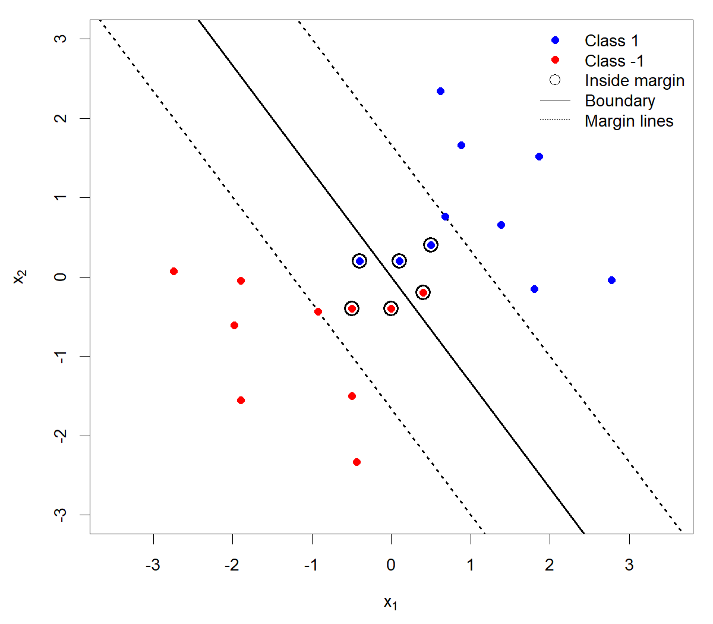
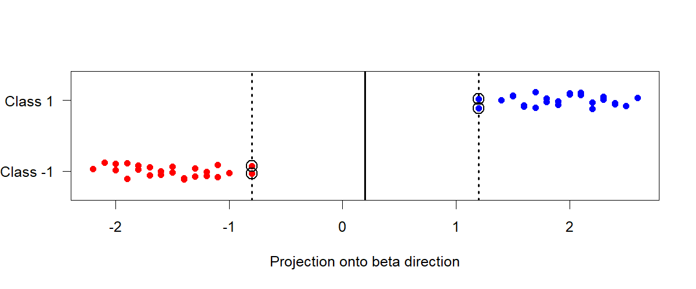

## Question 1: Boundary and margin

### Original question

Use `margin-geometry-20.csv` from the combined ZIP, which contains 20 observations with predictors $x_1,x_2$ and class labels $y\in\{-1,1\}$. Consider the score

$$
f(x)=0.8x_1+0.6x_2.
$$

Since $\|(0.8,0.6)\|_2=1$, the lines $f(x)=\pm1$ are each a distance 1 from the decision boundary $f(x)=0$.

a. Calculate the distance from every observation to the decision boundary and its functional margin $yf(x)$. In a table, report these values and whether each observation is inside, on, or beyond the margin for its class. Compare $yf(x)$ with 1 to make this distinction.

b. Plot the observations, the boundary $f(x)=0$, and the margin lines $f(x)=\pm1$. Distinguish the two classes and identify the observations inside the margin in your plot.

c. Report how many observations are inside, on, and beyond the margin. Which observations are misclassified by this decision rule?

Use the observation numbers supplied in the data. Set the $x_1$ axis to $[-3.2,3.2]$, set the $x_2$ axis to $[-3,3]$, and use an equal aspect ratio. Do not fit a new classifier for this question.

### Solution

The coefficient norm is 1, so each distance to the decision boundary is $|f(x)|$. The functional margin $yf(x)$ also tells us whether the observation is on the correct side. Compare it with 1 to classify the point's position relative to its class margin.

| Observation | $y$ | Distance | $yf(x)$ | Position |
|---:|---:|---:|---:|---|
| 1 | 1 | 1.00 | 1.00 | On |
| 2 | 1 | 1.35 | 1.35 | Beyond |
| 3 | 1 | 1.50 | 1.50 | Beyond |
| 4 | 1 | 1.70 | 1.70 | Beyond |
| 5 | 1 | 1.90 | 1.90 | Beyond |
| 6 | 1 | 2.20 | 2.20 | Beyond |
| 7 | 1 | 2.40 | 2.40 | Beyond |
| 8 | 1 | 0.64 | 0.64 | Inside |
| 9 | 1 | 0.20 | 0.20 | Inside |
| 10 | 1 | 0.20 | -0.20 | Inside |
| 11 | -1 | 1.00 | 1.00 | On |
| 12 | -1 | 1.30 | 1.30 | Beyond |
| 13 | -1 | 1.55 | 1.55 | Beyond |
| 14 | -1 | 1.75 | 1.75 | Beyond |
| 15 | -1 | 1.95 | 1.95 | Beyond |
| 16 | -1 | 2.15 | 2.15 | Beyond |
| 17 | -1 | 2.45 | 2.45 | Beyond |
| 18 | -1 | 0.64 | 0.64 | Inside |
| 19 | -1 | 0.24 | 0.24 | Inside |
| 20 | -1 | 0.20 | -0.20 | Inside |

The plot shows the decision boundary as a solid line and the two margin lines as dotted lines. Black rings mark the six observations inside the margin.

{width=70% fig-alt="Blue and red points represent two classes. A solid line marks the decision boundary, dotted lines mark the margins, and black rings surround six inside-margin points."}

There are **6 inside**, **2 on**, and **12 beyond** the margin. Observations **10 and 20** are misclassified because their functional margins are negative. Their distances to the boundary are positive, which is why distance alone does not identify a wrong-side observation.

::: {.callout-note collapse="true" title="R and Python calculations and plot"}
::: {.panel-tabset .sync-code-panels group="homework-08-language"}
#### R

```r
data_dir <- if (file.exists("data/margin-geometry-20.csv")) {
  "data"
} else {
  "practice/weeks/week-08/data"
}
q1 <- read.csv(file.path(data_dir, "margin-geometry-20.csv"))
q1$score <- with(q1, 0.8 * x1 + 0.6 * x2)
q1$distance <- abs(q1$score)
q1$margin <- q1$y * q1$score
q1$position <- ifelse(q1$margin < 1 - 1e-9, "Inside",
                      ifelse(q1$margin > 1 + 1e-9, "Beyond", "On"))

print(q1[, c("observation", "y", "distance", "margin", "position")],
      row.names = FALSE)
print(table(q1$position))
print(q1$observation[q1$margin < 0])

inside <- q1$position == "Inside"
plot(q1$x1, q1$x2, type = "n", xlim = c(-3.2, 3.2),
     ylim = c(-3, 3), asp = 1,
     xlab = expression(x[1]), ylab = expression(x[2]))
abline(a = 0, b = -4 / 3, lwd = 2)
abline(a = 5 / 3, b = -4 / 3, lty = 3, lwd = 2)
abline(a = -5 / 3, b = -4 / 3, lty = 3, lwd = 2)
points(q1$x1, q1$x2, col = ifelse(q1$y == 1, "blue", "red"), pch = 19)
points(q1$x1[inside], q1$x2[inside], pch = 1, cex = 1.9, lwd = 1.7)
legend("topright",
       c("Class 1", "Class -1", "Inside margin", "Boundary", "Margin lines"),
       col = c("blue", "red", "black", "black", "black"),
       pch = c(19, 19, 1, NA, NA), lty = c(NA, NA, NA, 1, 3),
       bty = "n", pt.cex = c(1, 1, 1.4, 1, 1))
```

#### Python

```python
from pathlib import Path
import numpy as np
import pandas as pd
import matplotlib.pyplot as plt

data_dir = Path("data")
if not (data_dir / "margin-geometry-20.csv").exists():
    data_dir = Path("practice/weeks/week-08/data")
q1 = pd.read_csv(data_dir / "margin-geometry-20.csv")
q1["score"] = 0.8 * q1["x1"] + 0.6 * q1["x2"]
q1["distance"] = q1["score"].abs()
q1["margin"] = q1["y"] * q1["score"]
q1["position"] = np.where(
    q1["margin"] < 1 - 1e-9, "Inside",
    np.where(q1["margin"] > 1 + 1e-9, "Beyond", "On")
)

print(q1[["observation", "y", "distance", "margin", "position"]]
      .round(2).to_string(index=False))
print(q1["position"].value_counts())
print(q1.loc[q1["margin"] < 0, "observation"].tolist())

fig, ax = plt.subplots(figsize=(6, 6))
xline = np.linspace(-3.2, 3.2, 200)
ax.plot(xline, -0.8 * xline / 0.6, "k-", lw=2, label="Boundary")
for level in (-1, 1):
    ax.plot(xline, (level - 0.8 * xline) / 0.6, "k:", lw=1.5,
            label="Margin lines" if level == -1 else None)
for label, color in [(1, "blue"), (-1, "red")]:
    class_obs = q1["y"] == label
    ax.scatter(q1.loc[class_obs, "x1"], q1.loc[class_obs, "x2"],
               color=color, label=f"Class {label}")
inside = q1["position"] == "Inside"
ax.scatter(q1.loc[inside, "x1"], q1.loc[inside, "x2"],
           facecolors="none", edgecolors="black", s=160,
           linewidths=1.5, label="Inside margin")
ax.set(xlim=(-3.2, 3.2), ylim=(-3, 3), xlabel="$x_1$", ylabel="$x_2$")
ax.set_aspect("equal", adjustable="box")
ax.legend(loc="upper right", frameon=False)
plt.show()
```
:::
:::

## Question 2: Margin in four dimensions

### Original question

Use `margin-geometry-4d.csv` from the combined ZIP, which contains 50 observations with four predictors and class labels $y\in\{-1,1\}$. Consider the linear score

$$
\begin{gathered}
f(\mathbf{x})=\beta_0+\mathbf{x}^{\mathsf T}\boldsymbol{\beta},\\
\beta_0=-1,
\quad
\boldsymbol{\beta}=(1,2,-2,4)^{\mathsf T}.
\end{gathered}
$$

a. Project the observations onto the direction of $\boldsymbol{\beta}$ and plot their positions on one axis. Distinguish the two classes and mark the decision boundary. Use the plot to calculate the geometric margin $M$, the distance from the boundary to the closest observation.

b. Express the same decision boundary using the SVM normalization in which the smallest functional margin $y_i f(\mathbf{x}_i)$ is set to 1. What are the corresponding values of $\boldsymbol{\beta}$ and $\beta_0$?

### Solution

For a one-dimensional view, project each observation onto the unit direction of $\boldsymbol{\beta}$:

$$
z_i=\frac{\mathbf{x}_i^{\mathsf T}\boldsymbol{\beta}}{\|\boldsymbol{\beta}\|}.
$$

Since $\|\boldsymbol{\beta}\|=5$, the decision boundary projects to $z=-\beta_0/5=0.2$. The closest negative-class observations, 15 and 36, are at $z=-0.8$; the closest positive-class observations, 4 and 33, are at $z=1.2$. Both are distance 1 from the boundary.

{width=85% fig-alt="Red negative-class and blue positive-class observations are positioned by their projections onto the beta direction. The solid vertical line at 0.2 is the decision boundary, the dotted lines at -0.8 and 1.2 mark distance 1, and black rings identify the four closest observations."}

The vertical offsets only make overlapping observations visible. The horizontal distances determine the margin. Every observation is on the correct side of the boundary. The closest observations have functional margin $y_i f(\mathbf{x}_i)=5$, so the geometric margin is

$$
M=\min_i\frac{y_i f(\mathbf{x}_i)}{\|\boldsymbol{\beta}\|}
=\frac{5}{5}=1.
$$

To make the smallest functional margin equal to 1, divide the entire score by 5:

$$
\beta_0^{\mathrm{SVM}}=-\frac15,
\qquad
\boldsymbol{\beta}^{\mathrm{SVM}}
=\left(\frac15,\frac25,-\frac25,\frac45\right)^{\mathsf T}.
$$

The closest observations now have functional margin 1, and $\|\boldsymbol{\beta}^{\mathrm{SVM}}\|=1$, so $M=1/\|\boldsymbol{\beta}^{\mathrm{SVM}}\|=1$. Rescaling changes the functional margins but leaves the boundary and geometric distances unchanged. This gives the SVM normalization of the supplied boundary; it does not establish that its direction maximizes the margin among all possible directions.

::: {.callout-note collapse="true" title="R and Python calculations and plot"}
::: {.panel-tabset .sync-code-panels group="homework-08-language"}
#### R

```r
data_dir <- if (file.exists("data/margin-geometry-4d.csv")) {
  "data"
} else {
  "practice/weeks/week-08/data"
}
q2 <- read.csv(file.path(data_dir, "margin-geometry-4d.csv"))
X <- as.matrix(q2[, c("x1", "x2", "x3", "x4")])
beta <- c(1, 2, -2, 4)
beta0 <- -1
score <- beta0 + drop(X %*% beta)
margin <- q2$y * score
smallest_margin <- min(margin)
M <- smallest_margin / sqrt(sum(beta^2))

closest <- abs(margin - smallest_margin) < 1e-9
print(data.frame(observation = q2$observation[closest],
                 y = q2$y[closest],
                 score = score[closest]),
      row.names = FALSE)
print(M)
beta_svm <- beta / smallest_margin
beta0_svm <- beta0 / smallest_margin
print(beta_svm)
print(beta0_svm)

z <- drop(X %*% beta) / sqrt(sum(beta^2))
boundary <- -beta0 / sqrt(sum(beta^2))
negative <- q2$y == -1
positive <- q2$y == 1
height <- numeric(nrow(q2))
height[negative] <- seq(-0.12, 0.12, length.out = sum(negative))
height[positive] <- 1 + seq(-0.12, 0.12, length.out = sum(positive))
plot(z, height, type = "n", ylim = c(-0.35, 1.35), yaxt = "n",
     xlab = "Projection onto beta direction", ylab = "")
axis(2, at = c(0, 1), labels = c("Class -1", "Class 1"), las = 1)
abline(v = boundary, lwd = 2)
abline(v = boundary + c(-M, M), lty = 3, lwd = 2)
points(z[negative], height[negative], pch = 19, col = "red")
points(z[positive], height[positive], pch = 19, col = "blue")
points(z[closest], height[closest], pch = 1, cex = 1.8, lwd = 1.5)
```

#### Python

```python
from pathlib import Path
import numpy as np
import pandas as pd
import matplotlib.pyplot as plt

data_dir = Path("data")
if not (data_dir / "margin-geometry-4d.csv").exists():
    data_dir = Path("practice/weeks/week-08/data")
q2 = pd.read_csv(data_dir / "margin-geometry-4d.csv")
X = q2[["x1", "x2", "x3", "x4"]].to_numpy()
beta = np.array([1, 2, -2, 4])
beta0 = -1
score = beta0 + X @ beta
margin = q2["y"].to_numpy() * score
smallest_margin = margin.min()
M = smallest_margin / np.linalg.norm(beta)

closest = np.isclose(margin, smallest_margin)
print(pd.DataFrame({"observation": q2.loc[closest, "observation"],
                    "y": q2.loc[closest, "y"],
                    "score": score[closest]}).to_string(index=False))
print("Geometric margin:", M)
beta_svm = beta / smallest_margin
beta0_svm = beta0 / smallest_margin
print("Canonical coefficients:", beta_svm)
print("Canonical intercept:", beta0_svm)

z = X @ beta / np.linalg.norm(beta)
boundary = -beta0 / np.linalg.norm(beta)
negative = q2["y"].to_numpy() == -1
positive = ~negative
height = np.empty(len(q2))
height[negative] = np.linspace(-0.12, 0.12, negative.sum())
height[positive] = 1 + np.linspace(-0.12, 0.12, positive.sum())
fig, ax = plt.subplots(figsize=(8, 3.5))
ax.axvline(boundary, color="black", lw=2)
for position in (boundary - M, boundary + M):
    ax.axvline(position, color="black", ls=":", lw=1.5)
ax.scatter(z[negative], height[negative], color="red")
ax.scatter(z[positive], height[positive], color="blue")
ax.scatter(z[closest], height[closest], facecolors="none",
           edgecolors="black", s=140, linewidths=1.5)
ax.set(xlabel="Projection onto beta direction", ylim=(-0.35, 1.35),
       yticks=[0, 1], yticklabels=["Class -1", "Class 1"])
plt.show()
```
:::
:::

## Question 3: Peer review of a Homework 7 skill

### Original question

The instructor's GitHub account, **rqzhu-aide**, will open a **GitHub Issue** in the repository containing your Homework 7 submission. It will link to **one** assigned student's repository.

1. **Use the skill.** Find the complete skill definition in the assigned student's Homework 7 report. Copy it without changes into a local `SKILL.md` file in your own folder. You do not need to install it. Give your agent the path to the file and explicitly ask it to follow that skill while analyzing the `SAheart` data, using the response and predictor coding from Homework 7. Provide the necessary data information, but no additional preferences about methods, figures, model selection, or report style. Let the skill direct the analysis.

   Monitor the time, your token use, and your weekly quota while the agent works. If the run is taking too long or using your allowance too quickly, you may send a **steer message** asking the agent to finish immediately, or stop the run and summarize what you observed. A steer message redirects an agent while it is working; learn how to send one in your AI tool before starting.

2. **Write a peer review.** Read the student's submitted report and what the skill produced in your run. Give a brief overall assessment, followed by **three major items the author could improve**. You may comment on any aspect of the skill or report. For each item, explain what you observed, why it matters, and what you recommend changing. If you stopped the run early, explain where and why. Write the review yourself, without AI assistance.

3. **Share your review.** Open a GitHub Issue in the assigned student's Homework 7 repository containing your review. Copy the same review into your Homework 8 submission report and include a link to the GitHub Issue.

### Solution

No solution can be provided for Question 3.
